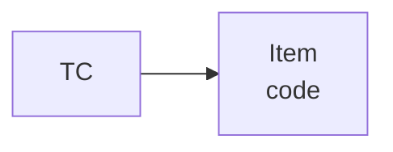

# Treasure drops

A drop picks a row of the treasure class table [C]. The picks are emulated in our own model [I].
The attack-speed breakpoint is 9 frames [C]. This is not confirmed by a run:

| Name | Weight |
|---|---|
| Cap | 3 |
| Skull Cap | 2 |

1. n: i32 ← tbl.Picks
2. r: u32 ← RNG.Range(n)

[Step through](../illustrations/maze/index.html)
